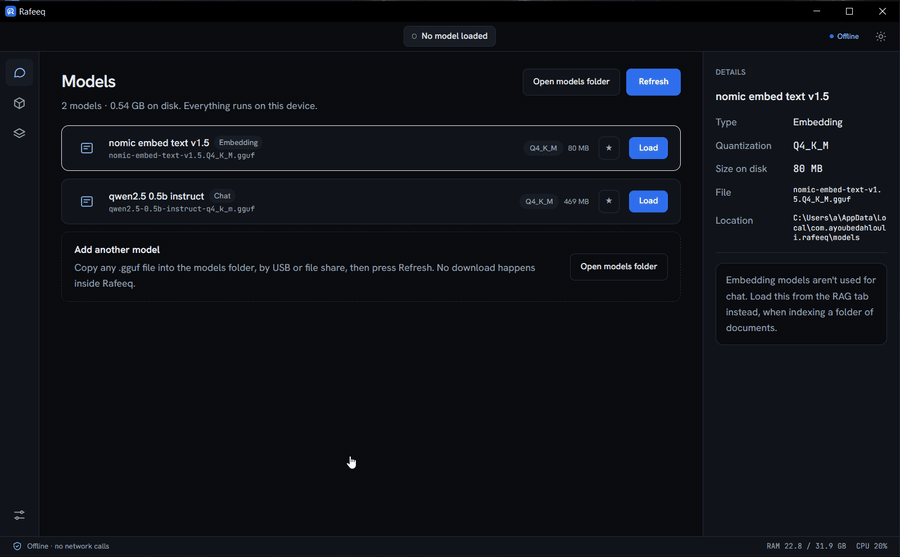

<div align="center">


# Rafeeq (رفيق)

**A fully offline, local AI assistant — for machines that will never see the open internet.**

Chat, code help, document Q&A, and local RAG, running a quantized LLM entirely on-device
via `llama.cpp`. **Zero network calls.** No API keys. No telemetry. No cloud, ever.

[](#installation)
[](https://tauri.app/)
[](https://react.dev/)
[](https://www.typescriptlang.org/)
[](https://www.rust-lang.org/)
[](https://github.com/ggerganov/llama.cpp)
[](#verifiably-offline)
[](LICENSE)

[Features](#features) · [Why](#why) · [Verifiably offline](#verifiably-offline) · [Getting a model](#getting-a-model) · [Installation](#installation) · [Roadmap](#project-status)

<br />



</div>

---

## 🤖 Why Rafeeq

Some development and work environments — corporate VMs, air-gapped networks, regulated
industries — block cloud AI tools entirely, even though that's exactly where a coding or
writing assistant would help most. Pasting a confidential document or a piece of internal
code into a hosted chatbot is a non-starter there, regardless of whether the network
block would even let you reach it.

Rafeeq takes the opposite approach from a hosted assistant:

| Principle | What it means |
| --- | --- |
| 🔒 **Offline by construction** | No code path in the app reaches the network — not a policy, a fact about the binary. |
| 🧠 **Your own model, your own machine** | A local `.gguf` model runs entirely on CPU via `llama.cpp`. Nothing is sent anywhere to generate a response. |
| 🕵️ **Your data stays local** | Documents, code, and conversations are processed on-device and never leave it. |
| 📦 **Bring your own model** | No bundled weights by default — pick the model that fits your hardware, your licensing needs, and your task. |
| 🧳 **Small and native** | A Tauri (Rust) shell instead of Electron — a few MB installer, fast startup, low memory footprint. |

> رفيق means "companion" in Arabic.

---

## ✨ Features

<table>
<tr>
<td valign="top" width="50%">

### 💬 Chat & Assistance
- **Local chat** — streamed responses from a quantized model running on CPU
- **Code-help mode** — paste or ask about code, get explanations and suggestions (no code execution)
- **Session history** — conversations saved automatically, resumable from the sidebar
- **Model profiles** — named shortcuts to sideloaded models for quick switching

### 📄 Documents & Knowledge
- **Document Q&A & summarization** — load a local `.txt`, `.md`, `.docx`, or `.pdf` and ask about its contents; long documents are truncated to fit context
- **Local RAG** — index a folder of documents with a sideloaded embedding model, then ask questions answered from the most relevant retrieved passages, with a dedicated no-match state instead of a guessed answer

</td>
<td valign="top" width="50%">

### 🧩 Model Management
- **Model manager** — point Rafeeq at sideloaded `.gguf` files, see type (chat/embedding), size, and quantization
- **Configurable generation** — temperature, CPU threads, max response length, all adjustable per session or as defaults
- **Tunable RAG** — chunk size, overlap, passages per question, and relevance threshold, all adjustable in-app

### 🛡️ Trust & Control
- **Offline verification** — a hand-maintained allowlist gate plus an in-app indicator confirm no network-capable plugin is registered in the build
- **Fabrication guard** — document and RAG answers are instructed to cite only what's explicitly present in the source text, not inferred or estimated numbers
- **Full theming** — light, dark, or system, with live OS-theme following

</td>
</tr>
</table>

### Planned

- OCR for scanned PDFs, via integration with [Naskh](#) (a companion offline OCR/document digitizer) so scanned documents can flow directly into Rafeeq's context
- macOS and Linux release builds

---

## 🛡️ Verifiably Offline

"Offline" is a claim worth checking, not just asserting. Rafeeq's zero-network guarantee
is enforced two ways.

### 1. In-app audit, every launch

Settings → Privacy and data shows a live "No network calls" indicator, backed by
[`offline_audit.rs`](src-tauri/src/offline_audit.rs) — a hand-maintained allowlist of
network-capable Tauri plugins. If one is ever registered in the build without a
deliberate edit to that file, the indicator flips and says so.

### 2. Static dependency audit — on every change

```bash
npm run check-offline
```

Fails the build if a known network-capable Tauri plugin
(`tauri-plugin-http`, `-updater`, `-shell`, `-websocket`, …) appears in either
`package.json` or `src-tauri/Cargo.toml`.

### 3. OS-level runtime block — before each release

Block the built binary's outbound traffic at the firewall and confirm the app behaves
identically — chat, document Q&A, and RAG all run the model locally, so nothing should
change with the network cut:

```powershell
# Build first: npm run tauri build
New-NetFirewallRule -DisplayName "Rafeeq-Block-Out" -Direction Outbound `
  -Program (Resolve-Path "src-tauri\target\release\rafeeq-desktop.exe") -Action Block
```

> 💡 For an even stronger guarantee, run the build inside a network-isolated VM
> (no virtual NIC, or a host-only adapter with no NAT).

---

## 🏗️ Tech Stack

| Layer | Technology |
| --- | --- |
| Shell / packaging | [Tauri 2](https://tauri.app) |
| Frontend | [React 19](https://react.dev/) + [TypeScript](https://www.typescriptlang.org/) + Tailwind CSS |
| Backend | Rust |
| Inference engine | [llama.cpp](https://github.com/ggerganov/llama.cpp) via [`llama-cpp-2`](https://github.com/eugenehp/llama-cpp-rs) |
| Model format | GGUF (quantized) |

Fonts (Hanken Grotesk, JetBrains Mono, Noto Sans Arabic) are bundled locally at build
time — nothing is fetched from a font CDN at runtime.

---

## 🧠 Default Model

Rafeeq ships without bundled model weights in the standard build — you sideload a
`.gguf` file yourself (see [Getting a model](#getting-a-model) below). This keeps the
installer small and lets you pick the model that fits your hardware and licensing needs.

Recommended default: **[Phi-4-mini-instruct](https://huggingface.co/microsoft/Phi-4-mini-instruct)**
(3.8B, MIT license), Q4_K_M quantization (~2.3GB), which runs on 8GB RAM machines with no GPU.

| Model | Size (Q4_K_M) | License | Notes |
| --- | --- | --- | --- |
| Phi-4-mini-instruct | ~2.3 GB | MIT | Default — strong reasoning for its size, 128K context |
| Qwen2.5 / 3.5 (3–4B) | ~2.3–2.6 GB | Apache 2.0 | Stronger multilingual support |

## 💻 Requirements

- **RAM:** 8GB minimum, 16GB recommended
- **CPU:** any x86 CPU with AVX2 (Intel Haswell / AMD Excavator, 2013+) or Apple Silicon — no GPU required
- **Disk:** a few MB for the app, plus the size of whichever model(s) you sideload

## 📥 Getting a Model

Rafeeq needs at least one `.gguf` model file before it can chat.

1. Download a model — e.g. [`Phi-4-mini-instruct-Q4_K_M.gguf`](https://huggingface.co/microsoft/Phi-4-mini-instruct) from Hugging Face on any machine with internet access
2. Transfer it to the target machine (USB drive, internal file share — whatever your environment allows)
3. Place it in Rafeeq's model directory. The easiest way to find it is the **Open models folder** button on the Models screen; the paths are:
   - **Windows:** `%LOCALAPPDATA%\com.ayoubedahlouli.rafeeq\models\`
   - **macOS:** `~/Library/Application Support/com.ayoubedahlouli.rafeeq/models/`
   - **Linux:** `~/.local/share/com.ayoubedahlouli.rafeeq/models/`

   The starter-model build uses its own folder: replace `com.ayoubedahlouli.rafeeq` with `com.ayoubedahlouli.rafeeq.bundled`.
4. Launch Rafeeq — it will detect the model automatically in the Model Manager

No internet access is required on the target machine at any point after the file is copied.

For local RAG, sideload a second, small embedding model (e.g. `nomic-embed-text-v1.5`)
into the same models directory — embedding models are not instruction-tuned for chat,
so they're kept separate from your chat model and selected from the Knowledge base page.

---

## 🚀 Installation

### From release

Download the latest installer for your platform from
[Releases](https://github.com/Ayoub-EDAHLOULI/Rafeeq/releases) (Windows `.exe` and `.msi`
for now). Two variants are published:

- **Rafeeq** — the standard, lean installer (~3MB). No model included; you sideload one yourself (see [Getting a model](#getting-a-model)). The right choice for air-gapped machines, since it doesn't force a large download over a restricted transfer channel.
- **Rafeeq (with starter model)** — a larger installer (~480MB) that bundles a small starter model (Qwen2.5-0.5B-Instruct, Q4_K_M) and installs it automatically on first launch. Intended for non-technical users on a normal internet-connected machine who don't want to find and sideload a model themselves. Installs side by side with the standard build (separate app identifier), and behaves identically once a model is loaded.

### From source

```bash
git clone https://github.com/Ayoub-EDAHLOULI/Rafeeq.git
cd Rafeeq
npm install
npm run tauri build
```

To build the bundled-starter-model variant yourself: download a `.gguf` model (e.g.
Qwen2.5-0.5B-Instruct, Q4_K_M) into a `models-bundle/` folder at the repo root
(gitignored, not committed), then run `npm run tauri:build:bundled`.

## 🧑‍💻 Development

```bash
npm install
npm run tauri dev
```

Requires the standard [Tauri prerequisites](https://tauri.app/start/prerequisites/)
(Rust toolchain, platform-specific webview dependencies) plus CMake, a C/C++ compiler
(MSVC on Windows), and LLVM/libclang for `bindgen` — all needed to compile `llama.cpp`
from source via `llama-cpp-sys-2` at build time. On Windows, set `LIBCLANG_PATH` if
`bindgen` can't find `libclang.dll` automatically.

---

## 🗺️ Project Status

<details>
<summary><b>Core — MVP</b> ✅</summary>

- [x] Model manager + local chat
- [x] Offline/air-gap verification tooling
- [x] Code-help mode
- [x] Document Q&A + summarization
- [x] Session history + model profiles
- [x] App shell redesign — icon rail, status bar, live RAM/CPU
- [x] Session panel — live temperature, system prompt, read-only context length
- [x] Settings page — theme, CPU threads, defaults, delete-all, About
- [x] RTL support (Arabic) and locally-bundled fonts

</details>

<details>
<summary><b>RAG milestone</b> ✅</summary>

- [x] Knowledge base page — per-folder indexing status (not indexed / indexing / paused / indexed)
- [x] Background indexing with live progress, pause, and resume
- [x] Configurable chunk size, overlap, and passages per question
- [x] RAG tab — folder filter pills, numbered source passages
- [x] Relevance threshold + no-match state (closest passages shown, no guessed answer)

</details>

<details>
<summary><b>Up next</b></summary>

- [ ] OCR for scanned PDFs (Naskh integration)
- [ ] macOS and Linux release builds
- [ ] Configurable models-folder location

</details>

First release (0.1.0, Windows) published.

---

## 🤝 Contributing

Issues and pull requests are welcome. The one non-negotiable rule: **no new network
calls.** Any change must keep `npm run check-offline` clean, and new dependencies must
not introduce a network-capable surface.

## 📄 License

Released under the [MIT License](LICENSE).

Base model weights are distributed separately under their own licenses (see
[Getting a model](#getting-a-model)); Rafeeq does not bundle or redistribute model
weights in the standard build.

<div align="center">
<br />
<sub>Built for the machines the internet forgot. 🤖</sub>
</div>
